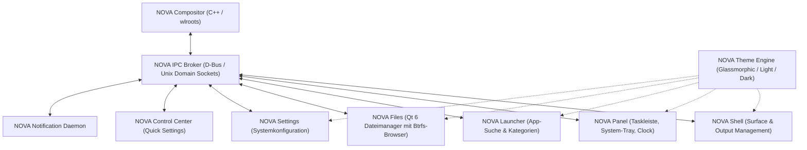

# ARCHITECTURE.md - NOVA OS Systemarchitektur

Dieses Dokument definiert die vollständige technische Architektur des **NOVA OS**-Betriebssystems.

---

## 1. Schichtenmodell der Gesamtsystemarchitektur

```mermaid
graph TD
    subgraph UI_Layer [Ebene 5: Benutzer- & Desktop-Umgebung]
        ND_Shell["NOVA Shell & Session"]
        ND_Compositor["NOVA Compositor (wlroots / Qt 6)"]
        ND_Panel["NOVA Panel & Taskbar"]
        ND_Launcher["NOVA Launcher"]
        ND_Files["NOVA Files (Btrfs-aware)"]
        ND_Settings["NOVA Settings & Control Center"]
        ND_Apps["NOVA Tools (Store, Update, Recovery, Hardware, Driver, Welcome)"]
    end

    subgraph Service_Layer [Ebene 4: Systemdienste & Schnittstellen]
        NM["NetworkManager"]
        PW["PipeWire & WirePlumber"]
        DBUS["D-Bus System & Session Broker"]
        POLKIT["polkit Privilege Management"]
        APPARMOR["AppArmor Security Engine"]
        NFT["nftables Firewall Engine"]
        VM_SVC["NOVA VM Integration Service (VBox / VMware)"]
    end

    subgraph Storage_Layer [Ebene 3: Paketverwaltung & Dateisysteme]
        DNF5["DNF5 / libsolv Engine"]
        RPM_DB["RPM v4 Package Database"]
        BTRFS_SUB["Btrfs Subvolumes (@, @home, @snapshots, @var_log)"]
        EXT4_FALLBACK["ext4 Dateisystem-Unterstützung"]
    end

    subgraph Platform_Layer [Ebene 2: Kernsystem & Toolchain]
        INIT["systemd (PID 1, Journald, Cgroups v2)"]
        GLIBC["glibc (GNU C Library)"]
        DRACUT["dracut Initramfs (Live & Target Boot)"]
        GRUB2["GRUB 2 Bootloader (UEFI / BIOS)"]
    end

    subgraph Hardware_Layer [Ebene 1: Kernel & Hardware-Abstraktion]
        KERNEL["Linux Kernel Stable (kernel.org)"]
        KMODS["Kernel-Module & DKMS"]
        DRM_KMS["DRM / KMS Grafiktreiber (amdgpu, i915/xe, nouveau, vmwgfx, vboxvideo)"]
        HW["Hardware (x86_64 PC, Oracle VirtualBox, VMware Workstation)"]
    end

    UI_Layer --> Service_Layer
    Service_Layer --> Storage_Layer
    Storage_Layer --> Platform_Layer
    Platform_Layer --> Hardware_Layer
```



---

## 2. Bootstrapping-Architektur (Zweistufiger Prozess)

Um die vollständige Unabhängigkeit von bestehenden Linux-Distributionen zu garantieren, wird NOVA OS über ein deterministisches zweistufiges Bootstrap-Verfahren aufgebaut:

```
[Host-System / Build-Container]
              │
              ▼ (Stage 0: Umgebungsprüfung & Manifest-Validierung)
   ┌───────────────────────────────────────────┐
   │ Toolchain-Quellen (GCC, Binutils, glibc, │
   │ Linux Kernel Headers, Make, M4, Bison)   │
   └───────────────────────────────────────────┘
              │
              ▼ (Stage 1: Cross-Toolchain Erstellung)
   ┌───────────────────────────────────────────┐
   │ Temporäre, isolierte Toolchain in /tools │
   │ Prefix: x86_64-nova-linux-gnu             │
   │ Unabhängig von Host-C-Bibliotheken       │
   └───────────────────────────────────────────┘
              │
              ▼ (Stage 2: Target-Chroot Aufbau)
   ┌───────────────────────────────────────────┐
   │ Kompilierung des Zielsystems in /sysroot  │
   │ Basispakete: glibc, coreutils, bash,     │
   │ systemd, rpm, dnf5, libsolv, python, etc. │
   └───────────────────────────────────────────┘
              │
              ▼ (Paketierungs-Initialisierung)
   ┌───────────────────────────────────────────┐
   │ Umwandlung der Sysroot-Komponenten in     │
   │ echte NOVA RPM-Pakete & Repositories      │
   └───────────────────────────────────────────┘
```

### Stage 1: Temporäre Toolchain (`/tools`)
- **Ziel**: Aufbau eines hermetischen Compilers (`x86_64-nova-linux-gnu-gcc`), der keine Header oder dynamischen Bibliotheken des Host-Betriebssystems linkt.
- **Komponenten**:
  1. `linux-headers`: Bereinigt aus dem offiziellen Kernel-Quellbaum.
  2. `binutils`: Statisch gelinkter Assembler und Linker (`ld.bfd`).
  3. `gcc-core`: Minimaler C-Compiler (Freestanding).
  4. `glibc`: Standard-C-Bibliothek, gebaut gegen die NOVA Linux-Header.
  5. `libstdc++` & `gcc-full`: Vollwertiger C/C++-Compiler.

### Stage 2: Target-Root (`/sysroot`)
- **Ziel**: Bau aller Basiswerkzeuge im Chroot mit der isolierten Stage-1-Toolchain.
- **Kernelemente**:
  - `systemd`: Init, systemd-udevd, systemd-journald, systemd-resolved, systemd-networkd.
  - `rpm` & `dnf5`: Die native Paketverwaltung, gebunden an `libsolv`.
  - `dracut`: Initramfs-Erzeugung.
  - `grub2`: Bootloader für UEFI x86_64 und BIOS i386-pc.

---

## 3. Dateisystem- und Speicher-Architektur

NOVA OS nutzt **Btrfs** als primäres Standarddateisystem mit Subvolume-Trennung und integriertem Snapshot-Rollback. Optional wird **ext4** als klassisches Dateisystem unterstützt.

### Btrfs Subvolume-Layout
| Subvolume | Mountpoint | Mount-Optionen | Zweck |
| :--- | :--- | :--- | :--- |
| `@` | `/` | `rw,noatime,compress=zstd:3,subvol=@` | Root-Dateisystem (Betriebssystemkern, Programme) |
| `@home` | `/home` | `rw,noatime,compress=zstd:3,subvol=@home` | Benutzerverzeichnisse (getrennt von OS-Snapshots) |
| `@snapshots` | `/.snapshots` | `rw,noatime,compress=zstd:3,subvol=@snapshots` | System-Wiederherstellungspunkte |
| `@var_log` | `/var/log` | `rw,noatime,subvol=@var_log` | System-Logs (bleiben bei System-Rollbacks erhalten) |
| `@swap` | `/swap` | `rw,noatime,nodatacow,subvol=@swap` | Dedizierte Swapfile (ohne Copy-on-Write) |

### Partitionierungs-Standard (UEFI)
1. **ESP (EFI System Partition)**:
   - Dateisystem: `FAT32`
   - Mountpoint: `/boot/efi`
   - Mindestgröße: `512 MB` (Typ `EF00`)
2. **Boot-Partition** (optional bei verschlüsselten Btrfs-Setups):
   - Dateisystem: `ext4`
   - Mountpoint: `/boot`
   - Größe: `1024 MB`
3. **NOVA System-Partition**:
   - Dateisystem: `Btrfs`
   - Enthält die definierten Subvolumes `@`, `@home`, `@snapshots`, `@var_log`, `@swap`.

---

## 4. Kernel- und Modul-Architektur

- **Quelle**: Neuester stabiler Upstream-Kernel von `kernel.org`.
- **Konfiguration (`nova_defconfig`)**:
  - Modularer Aufbau mit fest einkompilierten Speicher- und Dateisystemtreibern:
    - Built-in: `Btrfs`, `ext4`, `NVMe`, `AHCI (SATA)`, `USB Mass Storage`, `EFI Stub`, `AppArmor`, `OverlayFS`, `SquashFS`.
    - Module: WLAN-Treiber, Bluetooth, Sound (ALSA/HDA/SOF), Grafiktreiber (`amdgpu`, `i915`, `xe`, `nouveau`, `vmwgfx`, `vboxvideo`).
- **Kernel-Rollback & Mehrfach-Retention**:
  - NOVA OS hält stets mindestens zwei Kernel-Generationen vor:
    - `/boot/vmlinuz-nova-current` + `/boot/initramfs-nova-current.img`
    - `/boot/vmlinuz-nova-previous` + `/boot/initramfs-nova-previous.img`
  - Bei Boot-Fehlern oder Update-Abbrüchen erlaubt GRUB das sofortige Starten des Vorgänger-Kernels oder eines Recovery-Snapshots.

---

## 5. NOVA Desktop – Wayland- & UI-Architektur

Die Desktop-Umgebung ist eine Neuentwicklung auf Basis von **Wayland**, **wlroots**, **Qt 6** und **C++/Rust**:



### Komponenten-Spezifikation
1. **NOVA Compositor**:
   - Basiert auf `wlroots` und `Qt 6 Wayland Compositor API`.
   - Verantwortlich für Fenstermanagement (Floating & intelligentes Tiling), Rendern via OpenGL ES 2 / Vulkan, V-Sync, Fractional Scaling und Multi-Monitor-Layouts.
   - XWayland-Rootless-Server für nahtlose Rückwärtskompatibilität.
2. **NOVA Shell & Session Manager**:
   - Verwaltet den Lebenszyklus der Desktop-Sitzung (`nova-session.target` in systemd).
   - Reagiert auf Power-Events, Ruhezustand (Suspend/Hibernate) und Bildschirmsperre.
3. **NOVA Panel & Launcher**:
   - Dynamisches Panel mit konfigurierbaren Widgets: Start-Menü, aktive Fenster (Taskbar), Pager für virtuelle Desktops, System-Tray (StatusNotifierItem Protokoll), Audio-Regler, Netzwerk-Flyout und Kalender.
4. **NOVA Files**:
   - Schneller Qt 6 / C++ Dateimanager mit Multithreading, Tab-Unterstützung, Voransichten und nativer Btrfs-Snapshot-Zeitreise.
5. **NOVA Theme Engine**:
   - Zentraler D-Bus-Service für Systemstile.
   - Dynamisches Umschalten zwischen Light- und Dark-Mode, Akzentfarben und Transparenzeffekten ohne Applikationsneustart.

---

## 6. NOVA Systemwerkzeuge

| Werkzeug | Architektur & Technologien | Kernfunktionen |
| :--- | :--- | :--- |
| **NOVA Update** | C++ / Qt 6 + DNF5 C++ API | Atomare Systemupdates, Kernel-Aktualisierungen, automatische Snapshot-Erstellung vor Transaktionen, Rollback-Button |
| **NOVA Store** | C++ / Qt 6 + libsolv / Flatpak API | Anwendungszentrierter Store für RPM-Repositories und Flatpak/Flathub, App-Reviews, Kategorien, Update-Manager |
| **NOVA Hardware** | C++ / Qt 6 + sysfs / hwdata / udev | Detaillierte Systemanalyse: CPU-Mikroarchitektur, GPU-VRAM, RAM-Timings, SMART-Festplattenstatus, PCIe-Topologie |
| **NOVA Driver** | Python 3 / Qt 6 + udev / modalias | Automatische Identifikation proprietärer Hardware (NVIDIA, Broadcom, Realtek), sichere Installation signierter Treibermodule |
| **NOVA Recovery** | C++ / Shell + Btrfs CLI / GRUB | Zeitgesteuerte und manuelle Snapshot-Verwaltung, Ein-Klick-Systemwiederherstellung, Bootloader-Reparatur, Chroot-Notfallkonsole |
| **NOVA Welcome** | Qt 6 / QML | Erstkonfigurations-Assistent für Sprache, Tastaturlayout, Online-Verbindung, Dark/Light Mode und Einsteiger-Tipps |

---

## 7. Paketverwaltung und Repository-System

NOVA OS nutzt das **RPM v4**-Paketformat in Kombination mit **DNF5** und **libsolv**:
- **Repository-Struktur**:
  - `stable`: Gründlich getestete, produktionsreife Pakete. Kernel-Updates verweilen hier nur nach erfolgreichem VM- und Hardware-Stresstest.
  - `testing`: Integrationskanal für Paket-Aktualisierungen und neue Kernel-Releases.
  - `development`: Aktive Entwicklungsumgebung für Toolchain- und Desktop-Komponenten.
- **Metadaten & Signierung**:
  - Metadatengenerierung via `createrepo_c`.
  - Kryptografische Signierung aller RPM-Dateien und `repomd.xml` via GPG (4096-bit RSA).
  - Volle `libsolv`-Optimierung für minimale Speicher- und CPU-Last bei Paketabfragen.

---

## 8. Sicherheitsarchitektur

1. **Mandatory Access Control (AppArmor)**:
   - Strikte Profile für Webbrowser, Systemdienste, Netzwerkdämonen und den NOVA Store.
2. **Paketfilter (nftables)**:
   - Standard-Policy: `drop` auf der Ingress-Chain.
   - Erlaubt: `established`, `related`, Loopback (`lo`), mDNS/DHCP nur bei Bedarf.
   - Separate Tabellen für IPv4 und IPv6 (Inet-Familie).
3. **System Hardening**:
   - Compiler-Flags: `-O2 -march=x86-64-v3 -pipe -fstack-protector-strong -D_FORTIFY_SOURCE=3 -fcf-protection=full -fPIE -pie -Wl,-z,relro,-z,now`.
   - Kernel Hardening: `slab_nomerge`, `init_on_alloc=1`, `page_alloc.shuffle=1`, `pti=on`.
   - Rechteverwaltung: Deaktivierung von direktem Root-Login via SSH; `sudo`-Regeln mit Polkit-Berechtigungen.

---

## 9. Virtualisierungs-Architektur

VirtualBox und VMware sind First-Class-Plattformen von NOVA OS:
- **Automatische Gast-Erkennung (`nova-vm-detect`)**:
  - Beim Booten prüft systemd über DMI/CPUID (`systemd-detect-virt`), ob das System in VirtualBox oder VMware läuft.
  - Entsprechende Dienste (`vboxservice.service` oder `open-vm-tools.service`) werden automatisch ohne Benutzereingriff gestartet.
- **Treiber & 3D-Beschleunigung**:
  - VirtualBox: `vboxvideo` DRM-Treiber und VMSVGA-Grafikadapter.
  - VMware: `vmwgfx` DRM-Treiber und VMware SVGA II.
  - **Ausfallsicherheit**: Der NOVA Compositor fällt bei fehlender 3D-Beschleunigung nahtlos auf CPU-basiertes Software-Rendering (`llvmpipe` / `pixman`) zurück.

