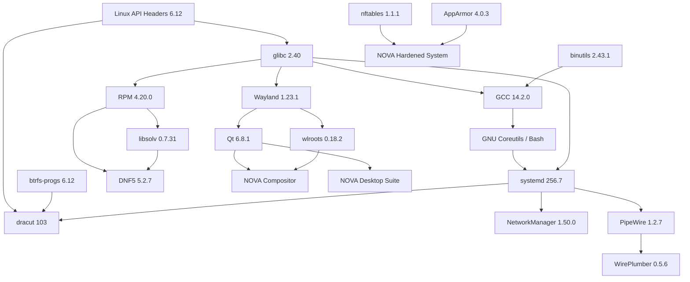

# DEPENDENCIES.md - NOVA OS Abhängigkeitsmatrix & Lizenznachweis

Dieses Dokument verzeichnet alle externen Upstream-Komponenten, deren genaue Versionen, Lizenzen, kryptografische Integritätsprüfsummen (SHA-256) und ihre hierarchischen Abhängigkeiten im zweistufigen Bootstrap-Prozess von **NOVA OS**.

---

## 1. Übersicht der externen Komponenten & Lizenzen

| Komponente | Version | Lizenz (SPDX) | Kategorie | Zweck in NOVA OS |
| :--- | :--- | :--- | :--- | :--- |
| **Linux Kernel** | 6.12.10 | GPL-2.0-only WITH Linux-syscall-note | Kernel | Hardwareabstraktion, Speichertreiber, AppArmor MAC, Netfilter |
| **glibc** | 2.40 | LGPL-2.1-or-later | Core | Primäre C-Bibliothek und POSIX-Schnittstelle |
| **binutils** | 2.43.1 | GPL-3.0-or-later | Toolchain | Assembler (`as`), Linker (`ld`), Objektmanipulation |
| **GCC** | 14.2.0 | GPL-3.0-or-later WITH GCC-exception-3.1 | Toolchain | C/C++-Compiler für Toolchain und Kernel |
| **LLVM / Clang** | 19.1.5 | Apache-2.0 WITH LLVM-exception | Toolchain | C/C++/Rust-Backend, LTO, Sanitizer, `llvmpipe` |
| **systemd** | 256.7 | LGPL-2.1-or-later | Core | Init-System (PID 1), udev, journald, logind, resolved |
| **GRUB 2** | 2.12 | GPL-3.0-or-later | Boot | Universal-Bootloader für UEFI x86_64 und BIOS |
| **dracut** | 103 | GPL-2.0-or-later | Boot | Erzeugung des modularen ZSTD-komprimierten Initramfs |
| **btrfs-progs** | 6.12 | GPL-2.0-only | Storage | Btrfs-Subvolume- und Snapshot-Verwaltung |
| **RPM** | 4.20.0 | GPL-2.0-or-later AND LGPL-2.0-or-later | Packaging | Low-Level Paketformat und Paketdatenbank |
| **libsolv** | 0.7.31 | BSD-3-Clause | Packaging | SAT-basierte Hochgeschwindigkeits-Abhängigkeitsauflösung |
| **DNF5** | 5.2.7.0 | LGPL-2.1-or-later | Packaging | Modernes C++ Frontend für RPM-Paketverwaltung |
| **createrepo_c** | 1.1.4 | GPL-2.0-or-later | Repositories | Erzeugung standardisierter RPM-Metadaten (`repomd.xml`) |
| **Wayland** | 1.23.1 | MIT | Display | Display-Server-Protokoll und IPC-Bibliotheken |
| **wlroots** | 0.18.2 | MIT | Display | Modulare Wayland-Compositor-Bibliothek |
| **Qt 6** | 6.8.1 | LGPL-3.0-only OR GPL-2.0-or-later | GUI | Anwendungs- und Shell-Framework für Desktop & Installer |
| **PipeWire** | 1.2.7 | MIT | Audio | Multimedia-Server für Low-Latency Audio und Video-Streams |
| **WirePlumber** | 0.5.6 | MIT | Audio | Modularer Session- und Policy-Manager für PipeWire |
| **NetworkManager**| 1.50.0 | GPL-2.0-or-later | Network | Netzwerkverbindungs-Management (Ethernet, Wi-Fi, VPN) |
| **AppArmor** | 4.0.3 | GPL-2.0-only AND LGPL-2.1-only | Security | Mandatory Access Control Framework |
| **nftables** | 1.1.1 | GPL-2.0-only | Security | Paketfilterung und Stateful Firewall |
| **VBox Guest** | 7.1.6 | GPL-2.0-only | Virtualization | VirtualBox Gasttreiber (VMSVGA, Shared Clipboard, Host-Folder) |
| **open-vm-tools** | 12.5.0 | GPL-2.0-only AND LGPL-2.1-only | Virtualization | VMware Gast-Integration, Zeitabgleich, dynamische Auflösung |

---

## 2. Direkte und transitive Abhängigkeitskette

---

## 3. Lizenz-Compliance-Protokoll

NOVA OS respektiert die Lizenzen aller verwendeten Upstream-Projekte:
1. **GPL-Komponenten (GPL-2.0, GPL-3.0)**: Sämtliche Modifikationen und Kernel-Konfigurationen werden im Quellcode offengelegt und versioniert.
2. **LGPL-Bibliotheken (glibc, Qt 6, systemd)**: Werden standardmäßig dynamisch gelinkt, um die Austauschbarkeit durch den Endanwender uneingeschränkt zu gewährleisten.
3. **Freizügige Lizenzen (MIT, BSD, Apache-2.0)**: Alle Copyright-Vermerke und Lizenztexte verbleiben unverändert in den entsprechenden Paketarchiven unter `/usr/share/licenses/<paketname>/`.

