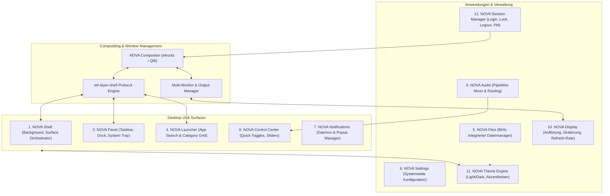

# DESKTOP.md - NOVA Desktop Architektur

Dieses Dokument beschreibt die Architektur, Modulorganisation, Wayland-Protokolle und IPC-Schnittstellen der eigenständigen Desktop-Umgebung **NOVA Desktop**.

---

## 1. Technisches Fundament & Differenzierung

NOVA Desktop ist eine von Grund auf neu entwickelte Desktop-Umgebung. Sie basiert weder auf GNOME Shell/Mutter noch auf KDE Plasma/KWin:

- **Display-Server & Compositor**: `wlroots` in Kombination mit der `Qt 6 Wayland Compositor API`.
- **Anwendungs- und UI-Framework**: `Qt 6` (C++20 & QML) mit Hardwarebeschleunigung via OpenGL ES 2 / Vulkan.
- **Systemdienste**: Rust und C++ für IPC-Dämonen, D-Bus-Services und Ressourcen-Management.
- **IPC & Protokolle**:
  - Wayland Core & Extensions (`xdg-shell`, `wlr-layer-shell`, `wlr-output-management`, `wlr-foreign-toplevel-management`).
  - D-Bus Interfaces (`org.nova.Shell`, `org.nova.Panel`, `org.nova.ThemeEngine`, `org.nova.Session`, `org.nova.Notifications`).

---

## 2. Die 12 Kernkomponenten

---

## 3. Schnittstellen & D-Bus Spezifikationen

### `org.nova.ThemeEngine`
- **Methoden**:
  - `SetThemeMode(String mode)`: `"light"` oder `"dark"`.
  - `SetAccentColor(String hexColor)`: z. B. `"#2563EB"`.
  - `GetThemeState()`: Gibt JSON mit aktuellen Stilen, Kontrasten und Transparenzen zurück.
- **Signale**:
  - `ThemeChanged(String mode, String accentColor)`

### `org.nova.Notifications` (Desktop Notifications Spec)
- Implementiert `org.freedesktop.Notifications`.
- Unterstützt Aktionen, Dringlichkeitsstufen (Low, Normal, Critical), App-Icons und Historien-Speicherung.

### `org.nova.Session`
- Reagiert auf Systemd-Logind Events.
- Schützt Sitzungen durch Sperrbildschirm (`nova-lock`).
- Führt sauberen Shutdown, Neustart und Suspend aus.

---

## 4. Multi-Monitor, Skalierung & Virtualisierung

- **Dynamische Auflösung**:
  - Über das `wlr-output-management`-Protokoll passt sich der Compositor in VirtualBox und VMware sofort der Fenstergröße des Hypervisors an.
- **Fractional Scaling**:
  - Native Unterstützung für Skalierungsfaktoren (z. B. 125%, 150%, 200%) über das Wayland Fractional-Scale-Protokoll (`wp_fractional_scale_manager_v1`).
- **Software-Rendering Fallback**:
  - Falls kein Hardware-OpenGL/Vulkan zur Verfügung steht (z. B. im Failsafe-Modus oder in älteren VMs), schaltet der Compositor automatisch auf `llvmpipe` oder `pixman` um.
